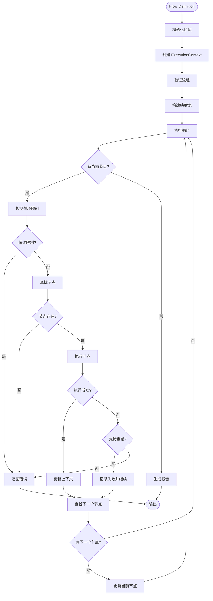
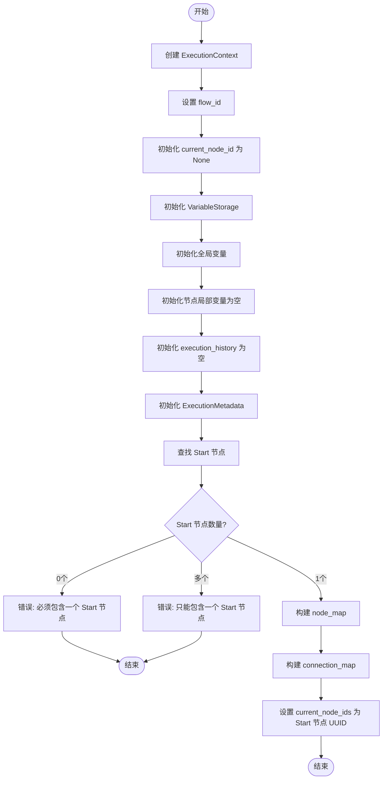
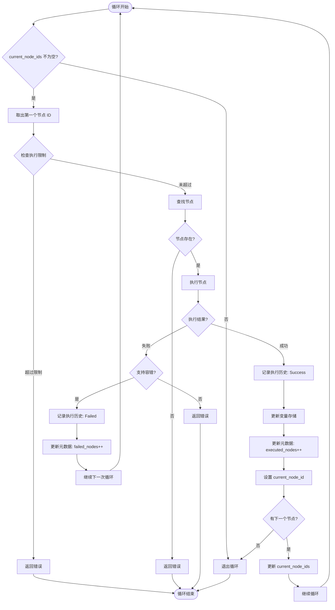
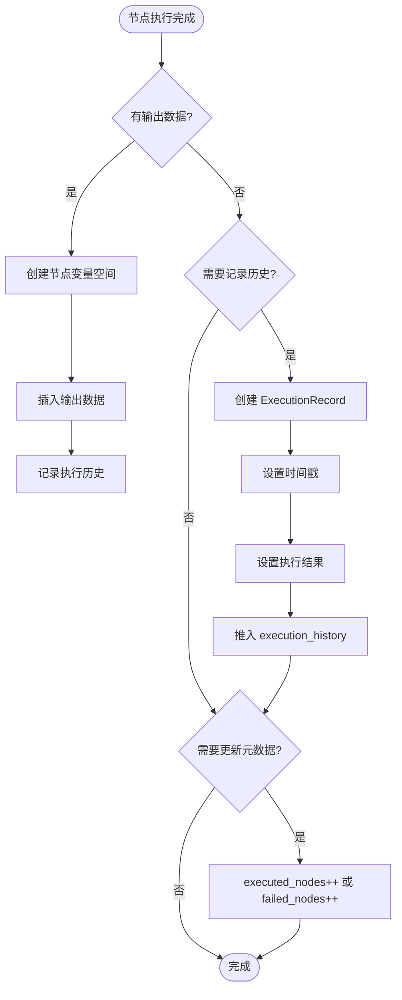
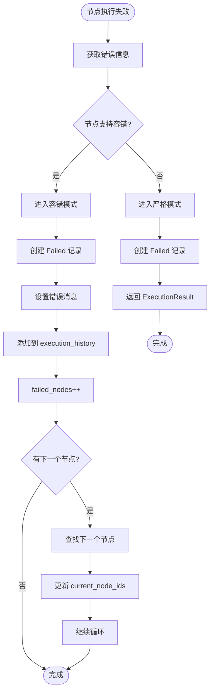

# 执行流程详细设计

**文档位置**：`docs/executor/execution_flow.md`
**语言**：中文
**版本**：v1.0
**参考文档**：`docs/executor_architecture.md`

---

## TL;DR

> **快速摘要**：本文档详细描述 Multi-Protocol Flow Executor 的执行流程，包括初始化、执行循环、上下文更新、错误处理和报告生成。
>
> **核心流程**：
> 1. **初始化阶段**：创建执行上下文、验证流程、构建映射表
> 2. **执行循环**：顺序执行节点、处理执行结果、查找下一个节点
> 3. **上下文更新**：变量管理、历史记录、元数据统计
> 4. **错误处理**：容错模式和严格模式的区分
> 5. **报告生成**：生成节点和流程级别的执行报告
>
> **设计特点**：
> - 顺序执行（单线程）
> - 节点隔离（独立输出空间）
> - 容错机制（失败后可继续）
> - 循环检测（限制最大执行次数）

---

## 1. 概述

### 1.1 执行流程总览

执行流程是指从输入 Flow Definition 到生成 ExecutionResult 的完整过程。整体流程可以分为以下阶段：

```
Flow Definition
    ↓
┌─────────────────────────────────────┐
│ 1. 初始化阶段                        │
│    ├─ 创建 ExecutionContext          │
│    ├─ 验证流程（查找 Start 节点）     │
│    └─ 构建映射表                     │
└─────────────────────────────────────┘
    ↓
┌─────────────────────────────────────┐
│ 2. 执行循环（重复直到没有下一个节点） │
│    ├─ 检测循环/限制重入               │
│    ├─ 执行当前节点                   │
│    ├─ 处理结果/错误                  │
│    ├─ 更新上下文                     │
│    └─ 查找下一个节点                 │
└─────────────────────────────────────┘
    ↓
┌─────────────────────────────────────┐
│ 3. 报告生成                          │
│    ├─ 生成节点执行报告               │
│    └─ 生成流程执行报告               │
└─────────────────────────────────────┘
    ↓
ExecutionResult
```

### 1.2 关键数据结构

**ExecutionContext**（执行上下文）
- 包含流程执行期间的所有状态
- 跟踪当前节点、变量、历史和元数据

**NodeExecutor**（节点执行器）
- 定义节点的执行行为
- 支持多种节点类型（Start、HTTP、Conditional、End、Loop）

**ExecutionResult**（执行结果）
- 包含执行成功/失败状态
- 包含执行报告和数据

---

## 2. 初始化阶段

### 2.1 创建 ExecutionContext

初始化阶段的第一步是创建执行上下文，该上下文将贯穿整个流程执行过程。

#### 2.1.1 ExecutionContext 结构

```rust
pub struct ExecutionContext {
    /// 流程 ID
    pub flow_id: String,
    /// 当前节点 ID
    pub current_node_id: Option<String>,
    /// 执行变量（用于变量替换）
    pub variables: VariableStorage,
    /// 执行历史
    pub execution_history: Vec<ExecutionRecord>,
    /// 执行元数据
    pub metadata: ExecutionMetadata,
}
```

#### 2.1.2 初始化步骤

1. **设置流程 ID**
   - 从 Flow 对象中提取 UUID
   - 用于日志追踪和报告生成

2. **初始化当前节点 ID**
   - 初始值为 None
   - 将在执行循环中更新

3. **初始化变量存储**
   - 从输入的初始变量创建 VariableStorage
   - 全局变量初始化为输入变量
   - 节点局部变量初始化为空 HashMap

```rust
let mut context = ExecutionContext {
    flow_id: flow.uuid.clone(),
    current_node_id: None,
    variables: VariableStorage::from_initial_variables(variables),
    execution_history: Vec::new(),
    metadata: ExecutionMetadata::new(),
};
```

#### 2.1.3 VariableStorage 结构

```rust
pub struct VariableStorage {
    /// 全局变量（初始变量 + 显式提升的变量）
    pub global: HashMap<String, serde_json::Value>,
    /// 节点局部变量（node_uuid -> 变量映射）
    pub nodes: HashMap<String, HashMap<String, serde_json::Value>>,
}
```

**设计要点**：
- 全局变量：在整个流程执行期间可访问
- 节点局部变量：每个节点有独立的输出空间
- 节点输出通过 `nodes.{uuid}.{key}` 访问

### 2.2 查找 Start 节点

#### 2.2.1 验证逻辑

每个有效的流程必须包含且仅包含一个 Start 节点。

```rust
let start_node = self.validate_and_find_start_node(&flow)?;
```

#### 2.2.2 查找步骤

1. **遍历所有节点**
   - 查找类型为 `NodeType::Start` 的节点

2. **验证节点数量**
   - 如果找到 0 个 Start 节点：返回错误"流程必须包含一个 Start 节点"
   - 如果找到多个 Start 节点：返回错误"流程只能包含一个 Start 节点"

3. **返回 Start 节点**
   - 返回找到的 Start 节点的引用

#### 2.2.3 伪代码

```
function validate_and_find_start_node(flow):
    start_nodes = []

    for node in flow.nodes:
        if node.type == NodeType::Start:
            start_nodes.append(node)

    if len(start_nodes) == 0:
        return Error("流程必须包含一个 Start 节点")

    if len(start_nodes) > 1:
        return Error("流程只能包含一个 Start 节点")

    return Ok(start_nodes[0])
```

### 2.3 构建映射表

为了高效查找节点和连接，需要构建两个映射表。

#### 2.3.1 Node Map（节点映射表）

**目的**：通过节点 UUID 快速查找节点对象

```rust
let node_map = self.build_node_map(&flow);
```

**数据结构**：
```rust
// UUID -> Node 引用
HashMap<String, &Node>
```

**构建步骤**：
```
function build_node_map(flow):
    node_map = HashMap()

    for node in flow.nodes:
        node_map[node.uuid] = node

    return node_map
```

#### 2.3.2 Connection Map（连接映射表）

**目的**：快速查找从某个节点出发的所有连接

```rust
let connection_map = self.build_connection_map(&flow);
```

**数据结构**：
```rust
// source_node_uuid -> Vec<Connection>
HashMap<String, Vec<Connection>>
```

**构建步骤**：
```
function build_connection_map(flow):
    connection_map = HashMap()

    for connection in flow.connections:
        source_uuid = connection.source_node_uuid

        if source_uuid not in connection_map:
            connection_map[source_uuid] = []

        connection_map[source_uuid].append(connection)

    return connection_map
```

#### 2.3.3 使用示例

执行节点时，通过 node_map 快速查找：
```rust
let node = node_map.get(&current_node_id)
    .ok_or_else(|| format!("节点 {} 不存在", current_node_id))?;
```

查找下一个节点时，通过 connection_map 快速查找：
```rust
let connections = connection_map.get(&node.uuid)
    .unwrap_or(&vec![]);
```

---

## 3. 执行循环

### 3.1 循环条件

执行循环采用顺序遍历的方式，从 Start 节点开始，沿着连接线逐个执行节点，直到没有下一个节点为止。

#### 3.1.1 循环结构

```rust
// 从 Start 节点开始遍历
let current_node_ids = vec![start_node.uuid.clone()];

while !current_node_ids.is_empty() {
    // 取出第一个节点（顺序执行）
    let current_node_id = current_node_ids[0].clone();

    // ... 执行节点 ...

    // 更新 current_node_ids
    // 如果没有下一个节点，设置 current_node_ids 为空，退出循环
}
```

#### 3.1.2 循环终止条件

1. **没有下一个节点**：当执行完最后一个节点（End 节点）时，`next_node_ids` 为空，退出循环
2. **执行失败（严格模式）**：当节点执行失败且不支持容错时，立即返回错误，退出循环
3. **超过最大执行次数**：当节点执行次数超过限制时，立即返回错误，退出循环

### 3.2 执行单个节点

#### 3.2.1 查找节点

```rust
let node = match node_map.get(&current_node_id) {
    Some(n) => n,
    None => {
        return ExecutionResult {
            success: false,
            error: Some(format!("节点 {} 不存在", current_node_id)),
            // ...
        };
    }
};
```

#### 3.2.2 检测循环/限制重入

```rust
if !self.check_execution_limit(&current_node_id) {
    return ExecutionResult {
        success: false,
        error: Some(format!("节点 {} 超过最大执行次数", current_node_id)),
        // ...
    };
}
```

**检查逻辑**：
```
function check_execution_limit(node_uuid):
    if node_uuid in execution_count:
        if execution_count[node_uuid] >= max_execution_count[node_uuid]:
            return false

    return true
```

**设计要点**：
- 每个节点有独立的最大执行次数限制
- 防止无限循环（如 Loop 节点）
- 允许重入（如条件分支回到前面的节点）

#### 3.2.3 执行节点

```rust
match self.execute_node(node, &context, &flow.connections, &node_map).await {
    Ok((next_node_ids, output_data)) => {
        // 处理成功情况
    }
    Err(error) => {
        // 处理失败情况
    }
}
```

**execute_node 方法**：
```
function execute_node(node, context, connections, node_map):
    根据 node.type 选择对应的 executor
    调用 executor.execute()
    返回 (next_node_ids, output_data)
```

**NodeExecutor Trait 接口**：
```rust
#[async_trait::async_trait]
pub trait NodeExecutor {
    async fn execute(
        &self,
        node: &Node,
        context: &ExecutionContext,
        connections: &[Connection],
        node_map: &HashMap<String, &Node>,
    ) -> Result<(Vec<String>, Option<serde_json::Value>), String>;

    fn is_fault_tolerant(&self, node: &Node) -> bool;

    fn max_retries(&self, node: &Node) -> u32;
}
```

### 3.3 处理执行结果

#### 3.3.1 成功处理

```rust
Ok((next_node_ids, output_data)) => {
    // 1. 记录执行历史
    context.execution_history.push(ExecutionRecord {
        node_uuid: node.uuid.clone(),
        timestamp: get_current_timestamp(),
        result: ExecutionResultType::Success,
    });

    // 2. 更新变量
    context.variables.insert_node_output(&node.uuid, output_data);

    // 3. 更新元数据
    context.metadata.executed_nodes += 1;

    // 4. 处理下一个节点
    if next_node_ids.is_empty() {
        // 没有下一个节点，终止执行
        break;
    } else {
        // 设置当前节点 ID 为第一个下一个节点
        context.current_node_id = Some(next_node_ids[0].clone());
        // 更新 current_node_ids
        current_node_ids = next_node_ids;
    }
}
```

**处理步骤**：
1. **记录执行历史**：将节点 UUID、时间戳、结果类型存入 execution_history
2. **更新变量**：将节点输出存入 VariableStorage
3. **更新元数据**：增加已执行节点计数
4. **处理下一个节点**：
   - 如果没有下一个节点，退出循环
   - 否则，更新 current_node_id 和 current_node_ids

#### 3.3.2 失败处理

```rust
Err(error) => {
    // 检查是否支持容错
    if node.executor().is_fault_tolerant(node) {
        // 容错模式：标记为失败但继续执行

        // 1. 记录执行历史
        context.execution_history.push(ExecutionRecord {
            node_uuid: node.uuid.clone(),
            timestamp: get_current_timestamp(),
            result: ExecutionResultType::Failed(error.clone()),
        });

        // 2. 更新元数据
        context.metadata.failed_nodes += 1;

        // 3. 继续执行下一个节点
        continue;
    } else {
        // 严格模式：立即终止

        return ExecutionResult {
            success: false,
            error: Some(error),
            // ...
        };
    }
}
```

**处理逻辑**：
1. **容错模式**：
   - 记录失败信息到执行历史
   - 增加失败节点计数
   - 继续执行下一个节点
2. **严格模式**：
   - 立即返回错误
   - 终止执行流程

### 3.4 查找下一个节点

#### 3.4.1 查找逻辑

```rust
// 在 execute_node 中，通过 connection_map 查找下一个节点
let connections = connection_map.get(&node.uuid)
    .unwrap_or(&vec![]);

let mut next_node_ids = Vec::new();

for connection in connections {
    next_node_ids.push(connection.target_node_uuid.clone());
}
```

#### 3.4.2 条件节点的特殊处理

条件节点有两个输出端口（true/false），根据评估结果选择分支：

```rust
// ConditionalNodeExecutor 的执行逻辑
async fn execute(
    &self,
    node: &Node,
    context: &ExecutionContext,
    connections: &[Connection],
    node_map: &HashMap<String, &Node>,
) -> Result<(Vec<String>, Option<serde_json::Value>), String> {
    // 1. 评估条件表达式
    let condition = evaluate_condition(&node.data.conditional.condition, &context.variables);

    // 2. 根据条件结果选择端口
    let selected_port = if condition { "true" } else { "false" };

    // 3. 查找对应的连接
    let next_node_ids = connections
        .iter()
        .filter(|conn| conn.source_port == selected_port)
        .map(|conn| conn.target_node_uuid.clone())
        .collect();

    // 4. 返回下一个节点 ID 和条件结果
    Ok((next_node_ids, Some(json!({ "condition": condition }))))
}
```

#### 3.4.3 流程图

```
┌─────────────────────────────────────┐
│         当前节点执行完成             │
└─────────────────────────────────────┘
                ↓
┌─────────────────────────────────────┐
│     查找从当前节点出发的连接         │
└─────────────────────────────────────┘
                ↓
┌─────────────────────────────────────┐
│         是否有连接？                 │
└─────────────────────────────────────┘
      ↓ 是             ↓ 否
┌─────────────┐   ┌─────────────┐
│ 收集所有目标 │   │ 返回空列表   │
│ 节点 UUID    │   │ 终止执行    │
└─────────────┘   └─────────────┘
      ↓
┌─────────────────────────────────────┐
│     是否是条件节点？                 │
└─────────────────────────────────────┘
      ↓ 是             ↓ 否
┌─────────────┐   ┌─────────────┐
│ 根据条件选择 │   │ 返回所有目标 │
│ 对应的分支   │   │ 节点 UUID    │
└─────────────┘   └─────────────┘
      ↓
┌─────────────────────────────────────┐
│       返回下一个节点 UUID 列表       │
└─────────────────────────────────────┘
```

---

## 4. 上下文更新

### 4.1 变量更新

#### 4.1.1 变量存储结构

```rust
pub struct VariableStorage {
    /// 全局变量（初始变量 + 显式提升的变量）
    pub global: HashMap<String, serde_json::Value>,
    /// 节点局部变量（node_uuid -> 变量映射）
    pub nodes: HashMap<String, HashMap<String, serde_json::Value>>,
}
```

#### 4.1.2 变量更新逻辑

```rust
impl VariableStorage {
    pub fn insert_node_output(
        &mut self,
        node_uuid: &str,
        output_data: Option<serde_json::Value>,
    ) {
        if let Some(data) = output_data {
            if !self.nodes.contains_key(node_uuid) {
                self.nodes.insert(node_uuid.to_string(), HashMap::new());
            }

            // 将输出数据存入节点的局部变量空间
            if let serde_json::Value::Object(map) = data {
                for (key, value) in map {
                    self.nodes.get_mut(node_uuid)
                        .unwrap()
                        .insert(key, value);
                }
            }
        }
    }

    pub fn get_variable(
        &self,
        path: &str,
    ) -> Option<&serde_json::Value> {
        // 支持的变量路径格式：
        // - "global.key"：全局变量
        // - "nodes.{uuid}.key"：节点局部变量
        // - "key"：默认查找全局变量

        if path.starts_with("global.") {
            let key = &path[7..];
            self.global.get(key)
        } else if path.starts_with("nodes.") {
            // 解析 nodes.{uuid}.key
            let parts: Vec<&str> = path[6..].split('.').collect();
            if parts.len() >= 2 {
                let node_uuid = parts[0];
                let key = &parts[1..].join(".");
                self.nodes.get(node_uuid)?.get(key)
            } else {
                None
            }
        } else {
            self.global.get(path)
        }
    }
}
```

#### 4.1.3 变量使用示例

```rust
// 在 HTTP 节点中使用变量
let url = replace_variables(
    &node.data.http.url,
    &context.variables
);
// 例如：url = "https://api.example.com/users/{{nodes.start.user_id}}"

// 在条件节点中使用变量
let condition = evaluate_expression(
    &node.data.conditional.condition,
    &context.variables
);
// 例如：condition = "nodes.http.status_code == 200"
```

### 4.2 执行历史记录

#### 4.2.1 执行记录结构

```rust
#[derive(Debug, Clone)]
pub struct ExecutionRecord {
    /// 节点 UUID
    pub node_uuid: String,
    /// 执行时间
    pub timestamp: u64,
    /// 执行结果
    pub result: ExecutionResultType,
}

#[derive(Debug, Clone)]
pub enum ExecutionResultType {
    Success,
    Failed(String),
    Skipped(String),
}
```

#### 4.2.2 记录时机

1. **成功执行后**：
   ```rust
   context.execution_history.push(ExecutionRecord {
       node_uuid: node.uuid.clone(),
       timestamp: get_current_timestamp(),
       result: ExecutionResultType::Success,
   });
   ```

2. **失败执行后（容错模式）**：
   ```rust
   context.execution_history.push(ExecutionRecord {
       node_uuid: node.uuid.clone(),
       timestamp: get_current_timestamp(),
       result: ExecutionResultType::Failed(error.clone()),
   });
   ```

3. **跳过节点后**（未来扩展）：
   ```rust
   context.execution_history.push(ExecutionRecord {
       node_uuid: node.uuid.clone(),
       timestamp: get_current_timestamp(),
       result: ExecutionResultType::Skipped(reason.clone()),
   });
   ```

#### 4.2.3 执行历史用途

- **调试**：追踪节点执行顺序和结果
- **报告生成**：生成详细的执行报告
- **性能分析**：计算节点执行时间
- **问题定位**：快速定位失败的节点

### 4.3 元数据统计

#### 4.3.1 元数据结构

```rust
#[derive(Debug, Clone)]
pub struct ExecutionMetadata {
    /// 流程开始时间
    pub flow_start_time: u64,
    /// 已执行节点数
    pub executed_nodes: u32,
    /// 失败节点数
    pub failed_nodes: u32,
    /// 跳过节点数
    pub skipped_nodes: u32,
}
```

#### 4.3.2 更新时机

1. **流程开始时**：
   ```rust
   let metadata = ExecutionMetadata {
       flow_start_time: get_current_timestamp(),
       executed_nodes: 0,
       failed_nodes: 0,
       skipped_nodes: 0,
   };
   ```

2. **成功执行节点后**：
   ```rust
   context.metadata.executed_nodes += 1;
   ```

3. **失败执行节点后（容错模式）**：
   ```rust
   context.metadata.failed_nodes += 1;
   ```

4. **跳过节点后**（未来扩展）：
   ```rust
   context.metadata.skipped_nodes += 1;
   ```

#### 4.3.3 元数据用途

- **统计信息**：提供流程执行的总体统计
- **报告生成**：在报告中显示执行统计
- **性能监控**：监控流程执行情况

---

## 5. 错误处理

### 5.1 节点执行失败

#### 5.1.1 错误类型

1. **执行错误**：节点执行过程中发生的错误（如 HTTP 请求失败）
2. **验证错误**：节点配置验证失败（如缺少必要参数）
3. **运行时错误**：运行时发生的意外错误（如类型转换失败）

#### 5.1.2 错误处理流程

```
节点执行失败
    ↓
检查节点是否支持容错
    ↓
    ├─ 是 → 容错模式
    │       ├─ 记录失败信息
    │       ├─ 更新元数据
    │       └─ 继续执行下一个节点
    │
    └─ 否 → 严格模式
            ├─ 记录失败信息
            └─ 立即终止执行
```

### 5.2 容错模式

#### 5.2.1 容错配置

```rust
fn is_fault_tolerant(&self, node: &Node) -> bool {
    // 默认实现：不支持容错
    false
}
```

**自定义实现**（例如：HTTP 节点）：
```rust
impl NodeExecutor for HttpNodeExecutor {
    fn is_fault_tolerant(&self, node: &Node) -> bool {
        // 从节点配置中读取容错设置
        node.data.http.fault_tolerant.unwrap_or(false)
    }
}
```

#### 5.2.2 容错处理逻辑

```rust
if node.executor().is_fault_tolerant(node) {
    // 容错模式：标记为失败但继续执行

    // 1. 记录执行历史
    context.execution_history.push(ExecutionRecord {
        node_uuid: node.uuid.clone(),
        timestamp: get_current_timestamp(),
        result: ExecutionResultType::Failed(error.clone()),
    });

    // 2. 更新元数据
    context.metadata.failed_nodes += 1;

    // 3. 继续执行下一个节点
    continue;
}
```

#### 5.2.3 使用场景

- **非关键节点**：节点的失败不影响整个流程的执行
- **重试机制**：配合重试机制，自动重试失败的节点
- **降级处理**：在节点失败时使用默认值

### 5.3 严格模式

#### 5.3.1 严格模式处理逻辑

```rust
if !node.executor().is_fault_tolerant(node) {
    // 严格模式：立即终止

    return ExecutionResult {
        success: false,
        error: Some(error),
        // ...
    };
}
```

#### 5.3.2 使用场景

- **关键节点**：节点的失败会导致整个流程失败
- **数据一致性**：需要确保所有步骤都成功执行
- **事务性操作**：需要原子性执行

#### 5.3.3 错误返回结构

```rust
pub struct ExecutionResult {
    /// 执行是否成功
    pub success: bool,
    /// 执行结果数据
    pub data: Option<serde_json::Value>,
    /// 错误信息（如果失败）
    pub error: Option<String>,
    /// 已执行的节点 UUID 列表
    pub executed_nodes: Vec<String>,
    /// 流程执行报告
    pub flow_report: Option<FlowExecutionReport>,
}
```

---

## 6. 报告生成

### 6.1 节点执行报告

#### 6.1.1 节点报告结构

```rust
pub struct NodeExecutionReport {
    /// 节点 UUID
    pub node_uuid: String,
    /// 节点类型
    pub node_type: NodeType,
    /// 节点名称
    pub node_name: String,
    /// 执行时间戳
    pub timestamp: u64,
    /// 执行状态
    pub status: ExecutionStatus,
    /// 执行时长（毫秒）
    pub duration_ms: Option<u64>,
    /// 输入数据
    pub input_data: Option<serde_json::Value>,
    /// 输出数据
    pub output_data: Option<serde_json::Value>,
    /// 错误信息（如果失败）
    pub error_message: Option<String>,
}

pub enum ExecutionStatus {
    Success,
    Failed,
    Skipped,
}
```

#### 6.1.2 生成节点报告

```rust
fn generate_node_report(
    &self,
    node: &Node,
    record: &ExecutionRecord,
    input_data: Option<serde_json::Value>,
    output_data: Option<serde_json::Value>,
    duration_ms: Option<u64>,
) -> NodeExecutionReport {
    let (status, error_message) = match &record.result {
        ExecutionResultType::Success => (ExecutionStatus::Success, None),
        ExecutionResultType::Failed(msg) => (ExecutionStatus::Failed, Some(msg.clone())),
        ExecutionResultType::Skipped(msg) => (ExecutionStatus::Skipped, Some(msg.clone())),
    };

    NodeExecutionReport {
        node_uuid: node.uuid.clone(),
        node_type: node.node_type.clone(),
        node_name: node.name.clone(),
        timestamp: record.timestamp,
        status,
        duration_ms,
        input_data,
        output_data,
        error_message,
    }
}
```

### 6.2 流程执行报告

#### 6.2.1 流程报告结构

```rust
pub struct FlowExecutionReport {
    /// 流程 UUID
    pub flow_uuid: String,
    /// 流程名称
    pub flow_name: String,
    /// 流程开始时间
    pub start_time: u64,
    /// 流程结束时间
    pub end_time: u64,
    /// 总执行时长（毫秒）
    pub total_duration_ms: u64,
    /// 执行状态
    pub status: FlowExecutionStatus,
    /// 节点执行报告列表
    pub node_reports: Vec<NodeExecutionReport>,
    /// 执行统计
    pub statistics: ExecutionStatistics,
}

pub enum FlowExecutionStatus {
    Success,
    Failed,
    PartialSuccess,  // 部分节点成功（容错模式）
}

pub struct ExecutionStatistics {
    /// 总节点数
    pub total_nodes: u32,
    /// 已执行节点数
    pub executed_nodes: u32,
    /// 成功节点数
    pub success_nodes: u32,
    /// 失败节点数
    pub failed_nodes: u32,
    /// 跳过节点数
    pub skipped_nodes: u32,
    /// 成功率
    pub success_rate: f64,
}
```

#### 6.2.2 生成流程报告

```rust
fn generate_flow_report(
    &self,
    context: &ExecutionContext,
    flow: &Flow,
    node_reports: Vec<NodeExecutionReport>,
) -> FlowExecutionReport {
    let end_time = get_current_timestamp();
    let total_duration_ms = end_time - context.metadata.flow_start_time;

    let status = if context.metadata.failed_nodes == 0 {
        FlowExecutionStatus::Success
    } else {
        FlowExecutionStatus::PartialSuccess
    };

    let statistics = ExecutionStatistics {
        total_nodes: flow.nodes.len() as u32,
        executed_nodes: context.metadata.executed_nodes,
        success_nodes: context.metadata.executed_nodes - context.metadata.failed_nodes - context.metadata.skipped_nodes,
        failed_nodes: context.metadata.failed_nodes,
        skipped_nodes: context.metadata.skipped_nodes,
        success_rate: calculate_success_rate(&context.metadata),
    };

    FlowExecutionReport {
        flow_uuid: flow.uuid.clone(),
        flow_name: flow.name.clone(),
        start_time: context.metadata.flow_start_time,
        end_time,
        total_duration_ms,
        status,
        node_reports,
        statistics,
    }
}

fn calculate_success_rate(metadata: &ExecutionMetadata) -> f64 {
    if metadata.executed_nodes == 0 {
        0.0
    } else {
        let success_count = metadata.executed_nodes - metadata.failed_nodes - metadata.skipped_nodes;
        (success_count as f64 / metadata.executed_nodes as f64) * 100.0
    }
}
```

### 6.3 报告输出

#### 6.3.1 JSON 格式报告

```json
{
  "flow_uuid": "550e8400-e29b-41d4-a716-446655440000",
  "flow_name": "API 集成流程",
  "start_time": 1707264000000,
  "end_time": 1707264060000,
  "total_duration_ms": 6000,
  "status": "Success",
  "statistics": {
    "total_nodes": 3,
    "executed_nodes": 3,
    "success_nodes": 3,
    "failed_nodes": 0,
    "skipped_nodes": 0,
    "success_rate": 100.0
  },
  "node_reports": [
    {
      "node_uuid": "660f9511-f39c-52e5-b827-557766551111",
      "node_type": "Start",
      "node_name": "开始",
      "timestamp": 1707264000000,
      "status": "Success",
      "duration_ms": 1,
      "input_data": null,
      "output_data": {
        "user_id": "12345"
      },
      "error_message": null
    },
    {
      "node_uuid": "77100622-g40d-63f6-c938-668877662222",
      "node_type": "Http",
      "node_name": "获取用户信息",
      "timestamp": 1707264001000,
      "status": "Success",
      "duration_ms": 2500,
      "input_data": {
        "url": "https://api.example.com/users/12345"
      },
      "output_data": {
        "status_code": 200,
        "body": {
          "id": 12345,
          "name": "张三"
        }
      },
      "error_message": null
    },
    {
      "node_uuid": "88211734-h51e-74g7-d049-779988773333",
      "node_type": "End",
      "node_name": "结束",
      "timestamp": 1707264003500,
      "status": "Success",
      "duration_ms": 1,
      "input_data": null,
      "output_data": null,
      "error_message": null
    }
  ]
}
```

---

## 7. 完整流程图

### 7.1 整体执行流程



### 7.2 初始化阶段详细流程



### 7.3 执行循环详细流程



### 7.4 上下文更新详细流程



### 7.5 错误处理详细流程



---

## 8. 伪代码完整示例

### 8.1 执行流程完整伪代码

```
// 主执行函数
function execute_flow(flow, variables):
    // ==================== 初始化阶段 ====================
    // 1. 创建执行上下文
    context = ExecutionContext {
        flow_id: flow.uuid,
        current_node_id: None,
        variables: VariableStorage.from_initial_variables(variables),
        execution_history: [],
        metadata: ExecutionMetadata.new()
    }

    // 2. 验证流程（查找 Start 节点）
    start_node = validate_and_find_start_node(flow)
    if start_node is Error:
        return ExecutionResult(success=false, error=start_node.message)

    // 3. 构建映射表
    node_map = build_node_map(flow)
    connection_map = build_connection_map(flow)

    // 4. 从 Start 节点开始遍历
    current_node_ids = [start_node.uuid]

    // ==================== 执行循环 ====================
    while not current_node_ids.is_empty():
        // 取出第一个节点
        current_node_id = current_node_ids[0]

        // 检测重入限制
        if not check_execution_limit(current_node_id):
            return ExecutionResult(
                success=false,
                error=f"节点 {current_node_id} 超过最大执行次数"
            )

        // 查找节点
        node = node_map.get(current_node_id)
        if node is None:
            return ExecutionResult(
                success=false,
                error=f"节点 {current_node_id} 不存在"
            )

        // 执行节点
        result = execute_node(node, context, flow.connections, node_map)

        // ==================== 处理执行结果 ====================
        if result is Success:
            // 成功处理
            output_data = result.output_data

            // 1. 记录执行历史
            context.execution_history.push({
                node_uuid: node.uuid,
                timestamp: get_current_timestamp(),
                result: Success
            })

            // 2. 更新变量
            context.variables.insert_node_output(node.uuid, output_data)

            // 3. 更新元数据
            context.metadata.executed_nodes += 1

            // 4. 查找下一个节点
            next_node_ids = find_next_nodes(node, connection_map)

            if next_node_ids.is_empty():
                // 没有下一个节点，终止执行
                break
            else:
                // 更新当前节点和节点列表
                context.current_node_id = Some(next_node_ids[0])
                current_node_ids = next_node_ids

        else:
            // 失败处理
            error = result.error

            // 检查是否支持容错
            if node.executor().is_fault_tolerant(node):
                // 容错模式：标记为失败但继续执行

                // 1. 记录执行历史
                context.execution_history.push({
                    node_uuid: node.uuid,
                    timestamp: get_current_timestamp(),
                    result: Failed(error)
                })

                // 2. 更新元数据
                context.metadata.failed_nodes += 1

                // 3. 查找下一个节点
                next_node_ids = find_next_nodes(node, connection_map)

                if next_node_ids.is_empty():
                    break
                else:
                    context.current_node_id = Some(next_node_ids[0])
                    current_node_ids = next_node_ids

            else:
                // 严格模式：立即终止
                return ExecutionResult(
                    success=false,
                    error: error
                )

    // ==================== 报告生成 ====================
    flow_report = generate_flow_report(context, flow)

    // ==================== 返回结果 ====================
    return ExecutionResult(
        success: true,
        data: {
            "flow_id": flow.uuid,
            "executed_nodes": context.metadata.executed_nodes,
            "failed_nodes": context.metadata.failed_nodes,
            "skipped_nodes": context.metadata.skipped_nodes
        },
        error: None,
        executed_nodes: [record.node_uuid for record in context.execution_history],
        flow_report: flow_report
    )
```

### 8.2 辅助函数伪代码

```
// 验证流程并查找 Start 节点
function validate_and_find_start_node(flow):
    start_nodes = []

    for node in flow.nodes:
        if node.type == NodeType::Start:
            start_nodes.append(node)

    if len(start_nodes) == 0:
        return Error("流程必须包含一个 Start 节点")

    if len(start_nodes) > 1:
        return Error("流程只能包含一个 Start 节点")

    return Ok(start_nodes[0])

// 构建节点映射表
function build_node_map(flow):
    node_map = {}

    for node in flow.nodes:
        node_map[node.uuid] = node

    return node_map

// 构建连接映射表
function build_connection_map(flow):
    connection_map = {}

    for connection in flow.connections:
        source_uuid = connection.source_node_uuid

        if source_uuid not in connection_map:
            connection_map[source_uuid] = []

        connection_map[source_uuid].append(connection)

    return connection_map

// 检查执行限制
function check_execution_limit(node_uuid):
    if node_uuid in execution_count:
        if execution_count[node_uuid] >= max_execution_count[node_uuid]:
            return false

    return true

// 查找下一个节点
function find_next_nodes(node, connection_map):
    connections = connection_map.get(node.uuid, [])

    // 如果是条件节点，根据条件结果选择分支
    if node.type == NodeType::Conditional:
        condition = evaluate_condition(node.data.conditional.condition, context)
        selected_port = "true" if condition else "false"

        next_node_ids = []
        for connection in connections:
            if connection.source_port == selected_port:
                next_node_ids.append(connection.target_node_uuid)

        return next_node_ids
    else:
        // 普通节点，返回所有目标节点
        return [conn.target_node_uuid for conn in connections]

// 生成流程报告
function generate_flow_report(context, flow):
    node_reports = []

    for record in context.execution_history:
        node = find_node_by_uuid(record.node_uuid)
        report = generate_node_report(node, record)
        node_reports.append(report)

    end_time = get_current_timestamp()
    total_duration_ms = end_time - context.metadata.flow_start_time

    status = Success if context.metadata.failed_nodes == 0 else PartialSuccess

    statistics = {
        total_nodes: flow.nodes.length,
        executed_nodes: context.metadata.executed_nodes,
        success_nodes: context.metadata.executed_nodes - context.metadata.failed_nodes,
        failed_nodes: context.metadata.failed_nodes,
        success_rate: calculate_success_rate(context.metadata)
    }

    return FlowExecutionReport {
        flow_uuid: flow.uuid,
        flow_name: flow.name,
        start_time: context.metadata.flow_start_time,
        end_time: end_time,
        total_duration_ms: total_duration_ms,
        status: status,
        node_reports: node_reports,
        statistics: statistics
    }
```

---

## 9. 总结

本文档详细描述了 Multi-Protocol Flow Executor 的执行流程，包括以下关键内容：

1. **初始化阶段**：创建执行上下文、验证流程、构建映射表
2. **执行循环**：顺序执行节点、处理执行结果、查找下一个节点
3. **上下文更新**：变量管理、历史记录、元数据统计
4. **错误处理**：容错模式和严格模式的区分
5. **报告生成**：生成节点和流程级别的执行报告

**设计特点**：
- 简单可靠的顺序执行（单线程）
- 节点隔离（独立输出空间）
- 容错机制（失败后可继续）
- 循环检测（限制最大执行次数）
- 完整的执行历史和报告

**相关文档**：
- 主文档：`docs/executor_architecture.md`
- 节点结构：`docs/node_structure.md`
- 报告结构：`docs/report_structure.md`

---

**文档结束**
