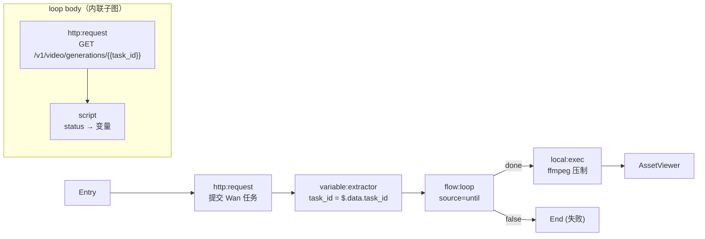

# `flow:loop` 循环节点 — 设计与实现规范

**状态**：草案（待实现） | **影响面**：`flow-engine-core` / `flow-engine-executor` / 前端三注册表

**相关**：图内任意位置的等待见 [`docs/flow-delay.md`](./flow-delay.md)；本节点的迭代间隔见 §3.6

---

## 1. 背景与目标

### 1.1 现状与约束

| 约束 | 证据 |
| :--- | :--- |
| 执行引擎**禁止图级环** | `crates/flow-engine-executor/src/executor.rs:2521` — `assert!(error_msg.contains("Flow contains a cycle"))` |
| 无 delay / loop 节点 | 节点类型清单见 `flow-engine-core/src/node.rs` |
| 子图执行能力已就绪 | `crates/flow-engine-executor/src/subgraph_runner.rs:29` `execute_subgraph`，已接收 `cancel_rx` 并在每个节点边界检查 `context.is_cancelled()`（`:154`） |
| 内联子图结构已就绪 | `flow-engine-core/src/flow.rs:10` `FlowSubGraph { nodes, connections }`，`flow.setup` / `flow.teardown` 已复用 |
| 表达式引擎已就绪 | `evalexpr 11`，`conditional_executor.rs:475` `evaluate_advanced_condition`（`inject_json_to_context` + `preprocess_expression`） |
| 画布已有"切换正在编辑的图"机制 | `stores/flow.ts` `activeStage: 'setup'\|'main'\|'teardown'` + `getStageGraph()` + `components/canvas/StageTabBar.tsx` |

**问题**：需要"提交 → 轮询 → 取结果"这类异步任务（如 Wan 3.0 视频生成）时，用户画不出轮询环，节点内部也无法表达。

### 1.2 目标

- 提供**一个**通用循环节点 `flow:loop`，覆盖 `items` / `count` / `until` 三种来源。
- body 为**内联子图**，画布上双击进入嵌套编辑（复用 stage 切换机制，泛化为作用域栈）。
- 异步任务轮询通过 `flow:loop` + 真实 `http:request` 节点组合实现，不引入专用 `async:wait` / `local:poll` 节点。
- **不**放开图级环校验。

### 1.3 非目标

| 非目标 | 原因 |
| :--- | :--- |
| 图级自由环 | 打穿调试器断点语义、压测每轮指标、报告按 `node_uuid` 去重 |
| `async:wait` 专用节点 | 由 `flow:loop` + `http:request` 组合覆盖，避免重复造轮子 |
| 超时后续跑（`attach` 模式） | 已定：循环超时即流程结束 |
| per-iteration 压测指标 | 见 §5.4 |
| webhook 回调式完成 / SSE 流式进度 | 不属于轮询模型 |

---

## 2. 节点契约

### 2.1 类型与端口

- 类型 ID：`flow:loop`
- 分类：`logic`（与 `conditional` 同组）
- 端口：

| 端口 | 位置 | 语义 |
| :--- | :--- | :--- |
| `done` | right | 正常结束（`exhausted` / `until` 命中） |
| `false` | bottom | 异常结束（`budget` / `depth` / `timeout` / `error` / `cancelled`） |

### 2.2 配置结构

```rust
// flow-engine-core/src/node_config.rs

/// 循环来源
#[derive(Debug, Clone, Serialize, Deserialize, PartialEq, Default)]
#[serde(rename_all = "snake_case")]
pub enum LoopSource {
    /// 不迭代，仅按 until 条件反复执行 body（异步任务轮询场景）
    Until,
    /// 遍历集合
    Items,
    /// 固定次数
    #[default]
    Count,
}

/// 循环节点配置
pub struct LoopConfig {
    /// 循环来源
    pub source: LoopSource,
    /// source=items 时的集合表达式（可含变量），展开为 JSON 数组
    pub items: Option<String>,
    /// source=count 时的次数
    pub count: Option<u32>,
    /// 每轮结束后的继续条件；为空表示不看条件只看来源与上限
    ///
    /// 语法为 evalexpr，可用 `loop.index` / `loop.item` / `loop.last` / body 导出变量
    pub until: Option<String>,
    /// 迭代间隔（毫秒），默认 0；上一轮结束后、下一轮开始前等待
    pub interval_ms: Option<u64>,
    /// 间隔退避系数，默认 1.0（不退避）；1.5 表示每轮间隔乘 1.5
    pub interval_backoff: Option<f64>,
    /// 间隔上限（毫秒），默认 10000
    pub interval_max_ms: Option<u64>,
    /// 首轮之前的等待（毫秒），默认 0；轮询场景用于避开"刚提交必然 queued"的无用查询
    pub initial_delay_ms: Option<u64>,
    /// 迭代硬上限（护栏），默认 100
    pub max_iterations: u32,
    /// 并发度，仅 source=items/count 且 until 为空时生效，默认 1
    pub concurrency: u32,
    /// 循环体（内联子图）
    pub body: FlowSubGraph,
    /// 导出到流程上下文的变量映射，形如 {"final_url": "$.last.url"}
    pub output_mappings: Option<HashMap<String, String>>,
    /// body 任一轮节点失败时是否跳出并走 false 端口，默认 true
    pub break_on_error: bool,
    /// 循环整体超时（毫秒），默认 600000；超时走 false 端口并终止流程
    pub timeout_ms: Option<u64>,
    /// 报告裁剪配置
    pub report: LoopReportConfig,
}

/// 循环报告配置
pub struct LoopReportConfig {
    /// 保留完整节点详情的迭代数，默认 20
    pub detail_iterations: u32,
    /// 失败轮是否始终保留完整详情，默认 true
    pub always_keep_failed: bool,
}
```

`NodeData` 新增变体：

```rust
/// 循环节点配置
#[serde(rename = "flow:loop")]
Loop(LoopConfig),
```

### 2.3 默认值与护栏

| 参数 | 默认值 | 说明 |
| :--- | :--- | :--- |
| `max_iterations` | 100 | 单节点迭代硬上限 |
| 全局迭代预算 | 1000 | 单次执行内所有 loop 节点累计迭代次数 |
| 嵌套深度 | 3 | body 内再放 `flow:loop` 的最大层数 |
| `detail_iterations` | 20 | 超出部分只留摘要 |
| `concurrency` | 1 | |
| `timeout_ms` | 600000 | 含所有 `interval_ms` 与 `initial_delay_ms` 等待时间 |
| `interval_ms` | 0 | 迭代间隔；轮询场景建议 3000 |
| `interval_backoff` | 1.0 | 大于 1 时按轮次指数放大间隔 |
| `interval_max_ms` | 10000 | 退避上限，防止间隔无限增长 |
| `initial_delay_ms` | 0 | 首轮前等待 |

超出任一护栏 → 走 `false` 端口，`break_reason` 分别为 `budget` / `depth` / `timeout`。

---

## 3. 执行语义

### 3.1 算法

```
入口
  ├─ 解析 items / count
  ├─ 检查嵌套深度 ≤ 3，否则 false(depth)
  ├─ initial_delay_ms > 0 → 可中断等待
  └─ loop:
       ├─ ctx.is_cancelled()?            → false(cancelled)
       ├─ 自上次迭代起超 timeout_ms?      → false(timeout)
       ├─ 全局迭代预算用尽?               → false(budget)
       ├─ iteration ≥ max_iterations?    → false(budget)
       ├─ 有下一项?（items/count）        → 无则 done(exhausted)
       ├─ 构造迭代作用域变量 loop.* / 注入共享变量
       ├─ execute_subgraph(body, vars, executor, cancel_rx)
       │    ├─ 失败且 break_on_error       → false(error)
       │    └─ 记录 iteration 报告
       ├─ until 非空且求值为 true          → done(until)
       ├─ 计算下一轮间隔 = min(interval_ms × backoff^iteration, interval_max_ms)
       ├─ 间隔 > 0 → 可中断等待（取消/超时即时中止）
       └─ 继续
```

- body 执行**直接复用** `execute_subgraph`（`subgraph_runner.rs:29`），它已经支持 `cancel_rx` 中途中止，因此 `flow:break` 无需新增内核能力。
- 单轮节点超时仍由各节点自身 `timeout_ms` 与 executor 的 `tokio::time::timeout` 包装（`executor.rs:836`）负责。

### 3.2 变量作用域

| 类别 | 可见性 | 生命周期 |
| :--- | :--- | :--- |
| 共享变量（loop 之前） | body 内可读 | 跨迭代保留 |
| 迭代局部变量（body 内写入） | body 内可读写 | **每轮结束丢弃** |
| `loop.index` / `loop.item` / `loop.first` / `loop.last` / `loop.count` | body 内可读 | 每轮重新注入 |
| `output_mappings` 声明的变量 | 流程下游可读 | 取最后一轮的值 |

**隔离是强制要求**：不做隔离时，第 5 轮可能读到第 3 轮的 `status`，异步任务轮询会静默出错。做法是每轮以「共享变量快照 + `loop.*`」重新构造 body 的执行上下文，与 `dataset_executor` 逐行重建 `runtime_variables` 的思路一致（`dataset_executor/executor.rs:249`），但不复用其代码（它重建的是整条流程上下文，loop 只需重建子图上下文）。

### 3.3 `until` 表达式

- 引擎：`evalexpr 11`，与 `conditional` 完全一致。
- 复用方式：把 `conditional_executor.rs:475` 的 `evaluate_advanced_condition` + `inject_json_to_context` + `preprocess_expression` 抽到 `flow-engine-executor/src/expression.rs`，`conditional` 与 `loop` 共同调用。
- 点号规则**沿用现状**：`loop.index` → `loop__index`，`$.last.status` → `last__status`（去除 `$.` 前缀）。
- 可用标识符：

```text
loop.index  loop.count  loop.first  loop.last  loop.item
last.<jsonpath>        // body 最后一个节点的输出
<共享变量与 body 导出变量>
```

- 示例：

```text
// 异步任务轮询
last.status == "SUCCESS" || last.status == "SUCCEEDED"

// 达到阈值即停
last.progress >= 100

// 集合模式下按元素字段筛停
loop.item.status == "done"
```

- 求值失败（语法错误 / 引用不存在的标识符）→ 走 `false` 端口，错误信息含原始表达式。

### 3.4 退出语义

| 退出原因 `break_reason` | 端口 | 说明 |
| :--- | :--- | :--- |
| `exhausted` | `done` | `items` 遍历完 / `count` 跑满 |
| `until` | `done` | `until` 求值为 true |
| `break` | `done` | body 内 `flow:break` 触发 |
| `budget` | `false` | 触达 `max_iterations` 或全局迭代预算 |
| `timeout` | `false` | 超出 `timeout_ms`，流程终止（不提供续跑） |
| `error` | `false` | body 节点失败且 `break_on_error = true` |
| `cancelled` | `false` | 用户取消执行 |

### 3.5 `flow:break` / `flow:continue`（P2）

| 节点 | 行为 |
| :--- | :--- |
| `flow:break` | 置位控制标记；`execute_subgraph` 在下一节点边界停下（`subgraph_runner.rs:154`），剩余节点记 `skipped`；loop 收到后走 `done` / `break` |
| `flow:continue` | 跳过本轮剩余节点，进入下一轮 |

两者仅在 `flow:loop` body 内有效；在 Main / Setup / Teardown 中直接使用时校验阶段报错。

### 3.6 迭代间隔与等待语义

| 规则 | 说明 |
| :--- | :--- |
| 位置 | `interval_ms` 在**上一轮结束、下一轮开始前**等待；`initial_delay_ms` 在首轮之前等待 |
| 退避 | 第 n 轮结束后的间隔 = `min(interval_ms × interval_backoff^n, interval_max_ms)`，n 为已完成轮数（从 1 开始）；`backoff = 1.0` 即固定间隔 |
| 计入超时 | 等待时间计入 `timeout_ms`，不会绕过总时限 |
| 可中断 | 等待用 `tokio::select!` 同时监听取消信号，取消/超时即时返回，不会睡满整个间隔 |
| 不测速 | 等待不计入节点 `duration_ms` 之外的统计口径；`iteration_summary.wait_ms` 单独记录 |

```rust
// 可中断等待（取消即时响应，沿用 subgraph_runner.rs:188-230 的既有写法）
async fn wait_or_cancel(ms: u64, ctx: &ExecutionContext) -> Result<(), LoopExit> {
    if ms == 0 { return Ok(()); }
    let sleep = tokio::time::sleep(Duration::from_millis(ms));
    match ctx.cancel_receiver.clone() {
        Some(mut rx) => tokio::select! {
            _ = sleep => Ok(()),
            _ = rx.changed() => Err(LoopExit::Cancelled),
        },
        None => { sleep.await; Ok(()) }
    }
}
```

> 现状：`ExecutionContext` 只提供非阻塞的 `is_cancelled()`（`context.rs:269`），`cancel_receiver` 字段需自行 clone + `changed()`。`subgraph_runner.rs:188-230` 已经在手写这段模式。建议顺手在 `ExecutionContext` 上补一个 `pub async fn wait_cancelled(&mut self)`，三个执行器共用，避免第四份重复。

**为什么放在 loop 上而不是靠 body 里的 delay 节点**：轮询节奏是循环的固有属性，放在 body 里会让 body 的第一个节点承担"节奏"职责，用户复制 body 复用到别的循环时会带上不该有的等待；而且放 body 里无法随轮次退避（delay 只在首轮前执行一次）。

---

## 4. 报告结构

### 4.1 类型变更（最小侵入）

```rust
// flow-engine-core/src/report.rs — NodeExecutionReport 新增
/// 所属迭代序号（0-based），仅 loop body 内的节点有值
#[serde(default, skip_serializing_if = "Option::is_none")]
pub iteration_index: Option<u32>,

/// 所属 loop 节点 uuid，仅 loop body 内的节点有值
#[serde(default, skip_serializing_if = "Option::is_none")]
pub iteration_of: Option<String>,

/// loop 节点的迭代摘要（仅 loop 节点自身有值）
#[serde(default, skip_serializing_if = "Option::is_none")]
pub iteration_summary: Option<Vec<IterationSummary>>,

/// 被裁剪掉的迭代数
#[serde(default, skip_serializing_if = "Option::is_none")]
pub truncated_iterations: Option<u32>,
```

```rust
/// 单轮迭代摘要
pub struct IterationSummary {
    pub index: u32,
    pub status: ExecutionStatus,
    pub duration_ms: u64,
    pub error: Option<ErrorDetail>,
}
```

**编码方式为平铺**：body 各节点的报告直接进入 loop 节点的 `node_reports`，每条带 `iteration_index` / `iteration_of`。理由：

- `SubFlowViewer` / `NodeExecutionDetails` 的递归渲染零改动；
- 导出 HTML / JUnit / `FlowCompareDialog` / 执行历史结构不变；
- 新字段全部 `skip_serializing_if = "Option::is_none"`，非 loop 场景报告**字节级不变**。

### 4.2 详情裁剪

- 保留**最近** `detail_iterations`（默认 20）轮的完整节点报告——有界桶，满桶后丢弃最旧的轮次（FIFO）；
- 被挤出桶的轮次只保留 `IterationSummary`，并计入 `truncated_iterations`；
- `always_keep_failed = true` 时失败轮被**钉住**：既不占桶容量，也不会被后续轮次挤出；
- `keep_all_details = true` 时**忽略** `detail_iterations`，每轮都保留完整详情（报告体积随迭代数线性增长，默认关闭）；把 `detail_iterations` 调成极大值等价于开启该开关，二者都**没有**上界保护。
- `iteration_summary` **永不裁剪**：无论保留策略如何，每一轮的序号/状态/耗时/等待/错误都在最终报告里；
- 裁剪只影响报告体积，不影响 `output_data` 与变量。

### 4.2.1 运行中实时推送

最终报告要等整个循环结束才产生，因此循环节点每轮结束都会推送一条
`ExecutionEvent::LoopIteration`：

```jsonc
{
  "loopIteration": {
    "nodeUuid": "loop-1",
    "iteration": { "index": 3, "status": "success", "duration_ms": 120, "wait_ms": 0 },
    "reports": [ /* 该轮 body 节点报告；按 §4.2 被裁剪时缺省 */ ],
    "truncated": false
  }
}
```

- 口径与最终报告一致（唯一例外是实时的 `wait_ms`，见下）：`iteration` ↔ `iteration_summary[i]`，
  `reports` ↔ `sub_flow_report.node_reports` 中该轮的条目（带 `iteration_index` / `iteration_of`）；
- 前端把它累积进 `useExecutionStore.loopProgressMap`，运行中的 `flow:loop` 节点
  直接复用 `LoopViewer` 渲染（`iteration_summary` / `truncated_iterations` /
  `sub_flow_report` 全部由实时数据补全）；
- 被裁剪的轮次事件不携带 `reports`（`truncated: true`），事件体积与报告裁剪策略一致；
- 前端 `loopProgressMap` 对**摘要**保留全部轮次，对**正文报告**只保留最近 100 轮
  （`MAX_LIVE_LOOP_REPORT_ROUNDS`）：长循环下每轮正文可达数百 KB，不设窗口会把 webview 内存撑爆；
  更早的轮次在实时视图里退化为"仅保留摘要"，最终报告仍由后端有界桶给出；
- 实时摘要的 `wait_ms` 恒为 `0`：该轮的等待时长要等本轮结束、进入下一轮间隔时才确定，
  为了不拖延推送（否则带 60s 间隔的循环要延迟一分钟才看到本轮结果），事件在轮次完成时立即发送，
  真实的 `wait_ms` 只体现在最终报告的 `iteration_summary` 里；
- 循环节点的 `NodeCompleted` 报告经热通道推送时会**剥离** `sub_flow_report`（大报文走冷通道），
  因此 `loopProgressMap` 的条目不会随 `nodeCompleted` 立即清除：详情面板在该报告被剥离时
  用实时进度补回各轮正文，流程剩余时间内仍可查看每一轮的结果；冷通道详情拉取到位或新一轮执行开始后自动让位；
- 清理时机：同一 loop 节点重新开始（`nodeStarted`）或新一轮流程开始（`flowStarted`）时清空。

### 4.3 节点输出

```jsonc
{
  "iterations": 37,
  "break_reason": "until",
  "last": { "status": "SUCCESS", "url": "https://..." },
  "results": [ /* 仅 collect=true 时存在，逐轮摘要 */ ]
}
```

下游通过 `{{<loop_uuid>.last.url}}` 或 `output_mappings` 导出的变量取值。

### 4.4 压测语义

Main 阶段中出现的 `flow:loop` **不作为 per-iteration 采样单元**：一次节点执行计一次，报告与指标标注 `loop_in_main: true`，QPS / P99 不按迭代拆分。

---

## 5. 前端

### 5.1 作用域栈（复用 stage 切换）

`activeStage` 由枚举泛化为作用域路径：

```ts
type CanvasScope = { kind: 'stage'; stage: FlowStage }
                 | { kind: 'loop'; loopNodeUuid: string };

// store: scopeStack: CanvasScope[]，栈顶即当前编辑的图
// getActiveGraph(flow, scopeStack) 取代 getStageGraph(flow, stage)
```

- Main 双击 `flow:loop` 节点 → push `{kind:'loop', loopNodeUuid}`；
- 面包屑 `Main / Loop: CAM-03 polling`，点击任一级回退；
- `StageTabBar` 扩展为 `ScopeBar`，复用现有节点计数 badge 与调试状态指示；
- 节点拖拽 / 连线 / 撤销 / 校验全部作用于栈顶图，无需新机制。

### 5.2 配置面板

`src/components/panels/LoopConfig.tsx` + `panels/schemas.ts`：

| 区块 | 字段 |
| :--- | :--- |
| 来源 | `source` 单选；items 时给集合输入；count 时给次数 |
| 终止 | `until` 表达式输入（与 `ConditionalConfig` 共用组件与语法高亮） |
| 节奏 | `initial_delay_ms`、`interval_ms`、`interval_backoff`、`interval_max_ms`（`source=until` 时默认展开，其余折叠） |
| 护栏 | `max_iterations`、`timeout_ms`、`concurrency`、`break_on_error` |
| 输出 | `output_mappings` 编辑器（复用 `panels/shared/OutputMappingsEditor`） |
| 报告 | `detail_iterations`、`always_keep_failed` |
| 进入循环体 | 按钮，等价于双击节点 |

### 5.3 Viewer

`src/components/execution/viewers/LoopViewer.tsx`：

- 顶部：`iterations / break_reason / 总耗时`；
- 按 `iteration_index` 分组的折叠列表，每组内渲染 body 节点（复用 `NodeExecutionDetails`）；
- 被裁剪轮次显示"仅摘要（共 N 轮）"提示；
- 失败轮默认展开。

### 5.4 注册表（三处必同步）

| 文件 | 条目 |
| :--- | :--- |
| `src/lib/NodeRegistry.ts` | `flow:loop` 元数据（图标、颜色、分类、端口、可嵌套标记） |
| `src/lib/configPanelRegistry.ts` | `flow:loop` → `LoopConfigPanel` |
| `src/lib/viewerRegistry.tsx` | `flow:loop` → `LoopViewer` |

后端：`flow-engine-executor/src/loop_executor.rs` + `default_registry.rs` 注册。

---

## 6. 异步任务组合示例（Wan 3.0）



- `until`：`last.status == "SUCCESS" || last.status == "SUCCEEDED"`
- 节奏：`initial_delay_ms: 3000` + `interval_ms: 3000` + `interval_backoff: 1.5` + `interval_max_ms: 10000`
- `max_iterations`：200（配合退避，约 10 分钟量级）
- `timeout_ms`：600000，超时走 `false` 并**终止流程**（不提供续跑节点）
- body 内只有真正的工作节点（轮询请求 + 状态提取），**不放等待逻辑**

```jsonc
// flow:loop 节点配置（Wan 轮询）
{
  "source": "until",
  "until": "last.status == \"SUCCESS\" || last.status == \"SUCCEEDED\"",
  "initial_delay_ms": 3000,
  "interval_ms": 3000,
  "interval_backoff": 1.5,
  "interval_max_ms": 10000,
  "max_iterations": 200,
  "timeout_ms": 600000,
  "break_on_error": true,
  "output_mappings": { "final_status": "$.last.status" },
  "body": { "nodes": [ /* http:request 轮询 + script 提取 */ ], "connections": [] }
}
```

等待语义完全由节点自身承担，body 复制到其他循环时不会带出多余的 sleep。

---

## 7. 验证计划

### 7.1 单测（`cargo nextest`）

| 用例 | 断言 |
| :--- | :--- |
| count 模式跑满 | `break_reason == "exhausted"`，body 执行 N 次，报告含 N 组 |
| until 提前命中 | `break_reason == "until"`，执行次数与命中轮一致 |
| items 空集合 | 直接 `done`，body 零次执行 |
| 迭代变量隔离 | 第 2 轮读不到第 1 轮写入的局部变量 |
| `output_mappings` | 下游能取到最后一轮导出的值 |
| `max_iterations` 触顶 | `false` + `break_reason == "budget"` |
| 全局迭代预算 | 两个 loop 累计超 1000 时第二个走 `false` |
| 嵌套深度 3 层 | 第 4 层校验期拒绝 |
| `break_on_error` | body 节点失败时 `false` / 继续，两种行为都覆盖 |
| 报告裁剪 | 50 轮时 `truncated_iterations == 30`，失败轮仍完整 |
| 取消 | 执行中取消 → `false` + `cancelled` |
| 取消中断等待 | `interval_ms = 60000` 时取消，**1 秒内**返回（不能睡满） |
| 固定间隔 | `interval_ms=3000, backoff=1.0`，3 轮总耗时 ≥ 6000ms 且 < 9000ms |
| 指数退避 | `interval_ms=1000, backoff=2.0, max=3000`，间隔序列为 2000/3000/3000/3000（首段即乘一次 backoff） |
| 首轮等待 | `initial_delay_ms=2000` 时首轮在 2s 后才执行 |
| 等待计入超时 | `timeout_ms=5000, interval_ms=3000` → `false` + `timeout`，不发生第 3 轮 |
| 表达式错误 | 语法错误 → `false`，错误含原表达式 |
| 序列化兼容 | 非 loop 报告 JSON 与非改动前字节级一致 |

### 7.2 手工验收

1. 画布双击进入 body，面包屑回退，撤销/重做正确；
2. 运行后 Viewer 按迭代分组，失败轮默认展开；
3. 压测 Main 内含 loop 时指标标注 `loop_in_main`；
4. 导出 HTML / JUnit 报告可读。

---

## 8. 风险与待验证项

| 项 | 状态 | 说明 |
| :--- | :--- | :--- |
| `asset:` 协议 Range 支持 | **源码级已确认，待运行期实测** | `tauri-2.11.5/src/protocol/asset.rs:90-150`：解析 `Range`、返回 `206`、`Content-Range`、`Accept-Ranges: bytes`，单段上限 1 MB 分块；`wry-0.55.1/src/webkitgtk/web_context.rs:157-167` 将 webview 请求头全量转发给处理器。仍需在 WebKitGTK 上实测 `<video>` 拖动进度条 |
| 报告类型变更影响导出格式 | 中 | 新字段全部 `skip_serializing_if`，需回归 `report_structure.md` 约定 |
| 嵌套画布的作用域栈改造 | 中 | 触及 `stores/flow.ts`、`FlowCanvas`、`StageTabBar`，需覆盖多标签页场景 |
| `evalexpr` 无 `in` 运算符 | 低 | 表达式统一用 `==` / `||` 书写，文档与面板提示中给出示例 |
| body 内 `flow:sub` 递归 | 低 | 已有 `call_stack` 递归防护 |

---

## 9. 实施顺序

1. `flow-engine-core`：`LoopConfig` + `DelayConfig` + `NodeData::{Loop, Delay}` + `NodeExecutionReport` 新字段（含序列化兼容测试）
2. `flow-engine-executor`：`delay_executor.rs`（最小、可中断，先落地验证 `tokio::select!` 取消路径）→ 抽出 `expression.rs`（先让 `conditional` 改用，跑回归）→ `loop_executor.rs` → 注册
3. 前端：三注册表 + `DelayConfigPanel` + `LoopConfigPanel` + `LoopViewer`
4. 画布：作用域栈 + `ScopeBar`
5. `flow:break` / `flow:continue`
6. 端到端：Gemini → Wan → ffmpeg 全链路

> `flow:delay` 排在第 2 步最前面：它只有一个字段、不依赖表达式引擎与子图执行，是最适合先打通"新节点接入三注册表 + 取消语义"的探路石。
