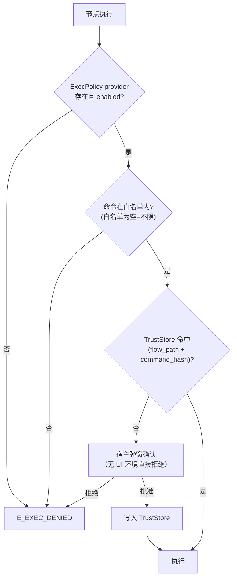

# `local:exec` / `local:sysinfo` 本地命令节点 — 设计与实现规范

**状态**：已实现（2026-11-05） | **影响面**：新 crate `flow-engine-exec` + `flow-engine-core`（NodeData/ErrorCode）+ app / CLI（策略注入）+ 前端三注册表

**相关**：[`docs/media-preview.md`](./media-preview.md)（产物捕获复用其 `media` 契约）、[`docs/flow-loop.md`](./flow-loop.md)

> **落地时的偏差（就地记录，避免与实现不一致）**
>
> 1. **`command_hash` 的 `program` 用解析后的绝对路径**（文档原文为"模板原文"）：`program` 可含变量，若用模板哈希，把 `{{ffmpeg_bin}}` 指向另一个二进制即可复用已有批准。
> 2. **策略 provider 的注入点从 6 处扩到 9 处**：Ingress 主请求、压测、数据集三条路径内部各自构造 `FlowExecutor`，不继承 provider；不注入则 `local:exec` 恒为 `E_EXEC_DENIED`，`--allow-exec` 形同虚设。
> 3. **进程终止由本 crate 自行实现**（`process::kill_process_group`）：`flow-engine/src/supervisor/process.rs` 属门面层且只杀单 pid，无进程组语义。
> 4. **CLI 策略在未 `--allow-exec` 时同样注入**（`enabled=false`），使 CLI 错误码统一为 `E_EXEC_DENIED` 而非"provider 缺失"。
> 5. **`--allow-shell` 为新增 CLI flag**（§4.5 的设置项在 CLI 侧的对应开关）。

---

## 1. 背景与目标

### 1.1 为什么需要

监控风格视频链路的最后一环是 ffmpeg 后处理（OSD 时间码、扫描线、降码率）。MPE 目前**没有任何本地进程执行能力**，链路断在最后一步：

```bash
ffmpeg -i "{{wan_video_url}}" -vf "scale=960:540,noise=…,drawtext=…" -c:v libx264 -crf 28 out.mp4
```

### 1.2 定位

**产品化安全**（非"自用快捷"）：`.mpf` 可被分享、可从市场安装、可在 CI 中批量执行，因此本地命令能力必须满足：

| 要求 | 含义 |
| :--- | :--- |
| 显式同意 | 用户第一次执行某条命令时看到完整命令并确认 |
| 变更即失效 | 命令或流程位置变化后必须重新确认 |
| 无 UI 环境默认拒绝 | `mpe run` / CI 必须显式开启 |
| 不可注入 | 变量不得拼接进 shell 字符串 |

### 1.3 非目标

| 非目标 | 说明 |
| :--- | :--- |
| OS 级沙箱 | 不做 seccomp / AppContainer / sandbox-exec；**不承诺**限制命令能触碰的文件 |
| 做成插件 | 见 §2 |
| 通用脚本语言（JS/Python） | 那是 `script` 节点与 `llm` 等插件的职责 |
| 长驻进程托管 | 一次性执行，不提供 daemon 生命周期管理 |
| 管道/重定向语法解析 | shell 模式交给系统 shell，argv 模式不支持管道 |

---

## 2. 决策记录：为什么是核心节点而不是插件

| 判据 | 结论 |
| :--- | :--- |
| 是否需要新依赖 | **否**。`std::process::Command` + `tokio::spawn_blocking`（workspace tokio 未启用 `process` feature，无需改依赖）；`sha2 = "0.10"`（`flow-engine-script` 已在用）；`base64` 已在 workspace |
| 防注入能否成立 | **只有核心节点可以**。宿主在分发前就已替换变量：`flow-engine-plugin/src/sidecar.rs:188` `resolve_variables_in_json(&raw_config, context)`，插件拿到的 `config` 是**已替换**的字符串，且 `referenced_variables` 只给变量名。插件既无法还原模板，也无法识别注入 |
| 策略 gate 在哪 | **无论如何都在宿主**。做插件也必须在分发前拦一道，否则策略等于由插件自己说了算 |
| 超时控制 | 核心节点走 executor 的 `tokio::time::timeout`（`flow-engine-executor/src/executor.rs:836`）；插件节点宿主**不套 timeout**（`execution_timeout_ms()` 对插件返回 `None`），只能靠 sidecar 包装超时，默认值来自设置项（默认 30s），跑 3 分钟的 ffmpeg 会被直接杀掉，需靠节点 `override_timeout_ms` 手动顶（`flow-engine-plugin/src/wrapper.rs:249-261`） |

**若将来改插件**，前置条件是 SDK 协议变更（`execute` 传 `raw_config`，或 `describe` 声明 `raw_fields` 让宿主跳过解析）→ `mpe-plugin-sdk` 发版 → 全部插件仓同步依赖版本。成本高，等出现第二个"需要在插件内执行危险操作"的场景再一并处理。

---

## 3. 节点契约

### 3.1 类型与端口

| 节点 | 类型 ID | 端口 |
| :--- | :--- | :--- |
| 本地命令 | `local:exec` | `true`（exit code 0）/ `false`（非 0 或执行失败） |
| 本机信息 | `local:sysinfo` | `out`（单出） |

分类 `tools`，`local:exec` 图标 `terminal`，`local:sysinfo` 图标 `cpu`。

### 3.2 配置结构

```rust
// flow-engine-core/src/node_config.rs

/// 命令构造方式
#[derive(Debug, Clone, Serialize, Deserialize, PartialEq, Default)]
#[serde(rename_all = "snake_case")]
pub enum ExecMode {
    /// 直接 argv 传参，不经过 shell（默认）
    #[default]
    Argv,
    /// 经由 shell 执行脚本
    Shell,
}

/// 产物捕获
pub struct ExecCaptureConfig {
    /// 产物路径（支持变量），相对路径以流程文件目录为基准
    pub path: String,
    /// 上限，默认 4MB；与媒体预览的 V1 阈值一致
    pub max_bytes: Option<usize>,
}

/// 本地命令节点配置
pub struct LocalExecConfig {
    /// argv / shell
    pub mode: ExecMode,

    // ---- argv 模式 ----
    /// 可执行文件（支持变量，如 "{{ffmpeg_bin}}"）
    pub program: Option<String>,
    /// 参数列表，逐参数做变量替换（安全，不经过 shell）
    pub args: Option<Vec<String>>,

    // ---- shell 模式 ----
    /// bash | sh | cmd | powershell | pwsh
    pub shell: Option<String>,
    /// 脚本正文。**不允许出现 `{{ }}`**（校验期拒绝）
    pub script: Option<String>,

    // ---- 公共 ----
    /// 变量映射：值可含 `{{ }}`，注入为环境变量 `MPE_VAR_<NAME>`
    pub env: Option<HashMap<String, String>>,
    /// 除白名单外额外继承的环境变量名
    pub inherit_env: Option<Vec<String>>,
    /// 工作目录（支持变量），默认流程文件所在目录
    pub cwd: Option<String>,
    /// 超时，默认 600000，上限受 ExecPolicy 约束
    pub timeout_ms: Option<u64>,
    /// stdout / stderr 各自上限，默认 1MB
    pub max_output_bytes: Option<usize>,
    /// 产物捕获（产物复用媒体预览的 `media` 契约）
    pub capture: Option<ExecCaptureConfig>,
}
```

`NodeData` 新增：

```rust
/// 本地命令节点配置
#[serde(rename = "local:exec")]
LocalExec(LocalExecConfig),
/// 本机信息节点
#[serde(rename = "local:sysinfo")]
LocalSysinfo(LocalSysinfoConfig),
```

`flow-engine-core/src/node_types.rs` 新增常量 `LOCAL_EXEC` / `LOCAL_SYSINFO`。

### 3.3 默认值与限制

| 项 | 默认 | 限制 |
| :--- | :--- | :--- |
| `timeout_ms` | 600000 | ≤ `ExecPolicy.max_timeout_ms`（默认 3_600_000，与 `subgraph_runner.rs:185` 的节点超时钳位一致） |
| `max_output_bytes` | 1 MiB | ≤ 16 MiB |
| `capture.max_bytes` | 4 MiB | ≤ 64 MiB；超出则 `omitted: true` |
| `cwd` | 流程文件目录 | `canonicalize` 后必须存在且为目录 |
| `args` 数量 | — | ≤ 256 |
| `script` 长度 | — | ≤ 64 KiB |

### 3.4 变量注入规则（核心安全语义）

**这是整个设计最关键的一条规则。**

| 位置 | 是否做变量替换 | 说明 |
| :--- | :--- | :--- |
| `program` | ✅ | 替换结果是可执行文件路径，不经 shell |
| `args[]` | ✅ 逐参数替换 | 替换结果作为**单个参数**传递，不经 shell 不拆词 |
| `env` 的值 | ✅ | 替换结果作为环境变量值 |
| `cwd` | ✅ | |
| `capture.path` | ✅ | |
| **`script`** | ❌ **禁止** | 校验期检测到 `{{` 即报错 |

shell 模式的脚本里访问变量只能通过环境变量：

```bash
# ✅ 唯一正确写法
ffmpeg -i "$MPE_VAR_video_url" -vf "$MPE_VAR_filter" -c:v libx264 -crf 28 "$MPE_VAR_out"
```

```jsonc
// 对应配置
"mode": "shell",
"shell": "bash",
"script": "ffmpeg -i \"$MPE_VAR_video_url\" -vf \"$MPE_VAR_filter\" -c:v libx264 -crf 28 \"$MPE_VAR_out\"",
"env": { "video_url": "{{wan_url}}", "filter": "scale=960:540,noise=…", "out": "{{out_path}}" }
```

环境变量名规范化：`env` 的 key 统一转大写、非字母数字下划线替换为 `_`，加 `MPE_VAR_` 前缀。同 key 冲突时校验期报错。

**为什么不做 `args` 的字符串拼接**：`std::process::Command::arg` 逐参数传递，操作系统层面就不存在拆词与解释，注入面为零。

### 3.5 产物捕获

执行成功后按 `capture.path` 读取文件，复用媒体预览 V1 的完全同构契约（`docs/media-preview.md` §3.2）：

```jsonc
"media": {
  "kind": "video",
  "mime": "video/mp4",
  "bytes": 662150,
  "data_url": "data:video/mp4;base64,…"
}
```

| 情况 | 行为 |
| :--- | :--- |
| 文件不存在 | 节点失败（`E_EXEC_CAPTURE_FAILED`），不产出 `media` |
| 文件 > `max_bytes` | 不读取，产出 `{ kind, mime, bytes, omitted: true }` |
| MIME 判定 | 由扩展名 + magic bytes 双重判定；两者冲突时以 magic 为准 |
| 未配置 `capture` | 不产出 `media` |

因为契约与 V1 一字不差，前端 `MediaPreview` **零改动**即可显示。

---

## 4. 安全模型

### 4.1 三层



### 4.2 `ExecPolicy`

```rust
/// 本地命令执行策略（由宿主或 CLI 注入）
pub struct ExecPolicy {
    /// 总开关
    pub enabled: bool,
    /// 允许的程序白名单（空 = 不限制，仅 enabled 生效）
    pub allowed_programs: Vec<String>,
    /// 是否允许 shell 模式
    pub allow_shell: bool,
    /// 单节点超时上限
    pub max_timeout_ms: u64,
    /// 审批模式
    pub approval: ApprovalMode,   // TrustStore | Always
}
```

注入方式（provider 名 `exec_policy`）：

```
FlowExecutor::with_provider("exec_policy", Arc::new(policy))   // executor.rs:186
context.get_provider::<ExecPolicy>("exec_policy")                    // context.rs:328
```

**缺省即拒绝**：取不到 provider → `E_EXEC_DENIED`，错误信息指明"本地命令执行未启用"。

注入点（6 处）：

| 位置 | 策略来源 |
| :--- | :--- |
| `src-tauri/src/tauri_commands.rs`（执行构建，约 `:182`） | `store/settings.bin` + 环境变量 |
| `mpe-cli/src/cli/run.rs:315`、`:342` | CLI flags |
| `mpe-cli/src/cli/run_node.rs:52` | CLI flags（AI agent 常用路径，必须有闸门） |
| `mpe-cli/src/cli/serve.rs:173`、`:305` | CLI flags |
| 调试执行器 | 透传同一 provider |

### 4.3 TrustStore

沿用仓库既有持久化方式（`tauri-plugin-store`，见 `src-tauri/src/lib.rs:349`）：

```
store/exec-trust.bin
{
  "approvals": [
    {
      "flow_path": "/abs/flows/cctv.mpf",
      "command_hash": "sha256:9f2c…",
      "created_at": 1762300000
    }
  ]
}
```

`command_hash` 输入（按顺序以 `\u{1f}` 拼接，UTF-8）：

```
flow 绝对路径 | 节点 uuid | 节点类型 | mode | 解析后的可执行文件绝对路径 | args 模板 或 script 原文 | cwd 模板
| inherit_env（排序、大写） | env 键值模板（排序） | capture.path 模板
```

要点：

| 规则 | 原因 |
| :--- | :--- |
| 用**模板原文**（未替换） | 变量值变化不触发重复确认；同时因为变量不进命令文本，不会成为绕过面 |
| `program` 用**解析后的绝对路径** | 否则把 `{{ffmpeg_bin}}` 指向另一个二进制即可复用已有批准 |
| 包含 `flow_path` | 复制/移动流程文件后自动失效，防止"批准 A 文件、执行 B 文件" |
| 包含节点 `uuid` | 同一流程里新增一个命令节点也要重新确认 |
| 包含 `inherit_env` / `env` / `capture.path` | 这三项能改变子进程可见的密钥与被内联进报告的产物；不入哈希就等于"改配置即可静默扩大权限" |
| 流程未保存时 | 无 `flow_path`，改用 `flow.uuid` 并标注"批准仅在本次会话有效"（不写盘） |

### 4.4 同意流程

1. 执行到节点 → 策略校验通过但 TrustStore 未命中；
2. 宿主（GUI）弹窗展示：解析后的可执行文件绝对路径、完整参数或脚本、`cwd`、将注入的环境变量**名**（`MPE_VAR_*`）与**额外继承的宿主变量名**（两者都不显示值，避免密钥上屏）、风险提示文案；
3. 用户批准 → 写 TrustStore → 执行；拒绝 → `E_EXEC_DENIED`（走 `on_error` 策略）。

无 UI 环境（CLI / serve / 数据集后台）未授权时**不弹窗、直接拒绝**，错误信息提示 `--allow-exec`。

### 4.5 设置页

`Settings → 本地命令`：

| 控件 | 说明 |
| :--- | :--- |
| 总开关 | 默认关 |
| 允许 shell 模式 | 默认关 |
| 程序白名单 | 逗号分隔，留空表示不限制 |
| 已批准列表 | 展示 `flow_path` + 命令摘要 + 时间，支持逐条撤销 |
| 清空全部批准 | 二次确认 |

### 4.6 威胁模型

| 攻面 | 缓解 | 残余风险 |
| :--- | :--- | :--- |
| 分享的 `.mpf` 携带恶意命令 | 首次确认 + 哈希固定 | 用户点了"批准" |
| 变量注入（HTTP 响应被拼进命令） | shell 模式禁止 `{{ }}`；argv 逐参数 | 无 |
| CI 里跑未知 flow | 默认拒绝，需 `--allow-exec` | 使用者主动放开 |
| 流程被篡改 | 哈希随模板变化 | 无 |
| 子进程后台逃逸（`&`、`nohup`） | 进程组终止（§5.3）；会话结束时扫描残留 | 极端情况可能残留 |
| 命令破坏用户文件 | **无缓解** | 明确写入 UI 提示，不承诺沙箱 |
| 输出刷屏 | stdout/stderr 上限 | 无 |

---

## 5. 执行语义

### 5.1 算法

```
1. 解析配置：program/args/env/cwd 逐字段替换（script 不替换）
2. 策略校验：provider 存在 → enabled → 白名单 → shell 许可
3. 审批校验：TrustStore / 弹窗
4. 构造命令：
   argv  ：Command::new(resolved_program).args(resolved_args)
   shell ：Command::new(shell).arg(flag).arg(script)      // bash -c / cmd /C / pwsh -Command
5. 环境：清洗后白名单继承 + MPE_VAR_*
6. cwd：resolve_file_path(cwd)，校验存在且为目录
7. 捕获输出（带上限），等待退出
8. 超时（timeout_ms）或取消（cancel_receiver）→ 终止进程组
9. exit code 0 → true 端口；非 0 → false 端口（error 里带 stderr 尾部）
10. 若配置 capture：读取产物 → media 契约
```

**在 `spawn_blocking` 中执行**（workspace tokio 未启用 `process` feature），用 `std::process::Command` + `Child::try_wait` 轮询；超时/取消走 `terminate_process`。

### 5.2 输出上限

`stdout` / `stderr` 各自异步读取到固定缓冲区，超过 `max_output_bytes` 后**继续读并丢弃**（不阻塞子进程，否则管道写满会死锁），末尾追加 `…[truncated N bytes]`。

`output_data` 里同时给出 `stdout_truncated` / `stderr_truncated: bool`。

### 5.3 取消与进程组终止

复用 `flow-engine/src/supervisor/process.rs`：

- Unix：SIGTERM → 5s 后 SIGKILL；
- Windows：`taskkill /PID <pid> /T /F`（`/T` 连子进程）。

等待模式沿用 `subgraph_runner.rs:188-230` 的 `cancel_receiver.clone()` + `tokio::select!` 写法。

### 5.4 shell 模式的平台差异

| 平台 | shell 默认 | 调用形式 |
| :--- | :--- | :--- |
| Linux / macOS | `/bin/sh` | `sh -c "<script>"` |
| Windows | `cmd.exe` | `cmd /C "<script>"` |
| 显式指定 `pwsh` | `pwsh` | `pwsh -NoProfile -Command "<script>"` |

Windows 下 `cmd /C` 的引号规则与 Unix 不同，文档与 UI 提示中给出示例，不做事后转义（转义本身就是注入面）。

### 5.5 环境变量清洗

| 类别 | 处理 |
| :--- | :--- |
| 默认继承 | `PATH` `HOME` `TMPDIR` `TEMP` `TMP` `LANG` `LC_ALL` `SYSTEMROOT` `WINDIR` `COMSPEC` `PATHEXT` |
| `inherit_env` 显式列出 | 追加继承 |
| 宿主内部变量 | **不继承**（所有 `MPE_*`，避免配置/密钥泄漏） |
| 注入 | `MPE_VAR_<NAME>` |

---

## 6. `local:sysinfo`

只读信息节点，**不需要审批**（不执行任意命令、不接受程序名）。

| 分组 | 字段 |
| :--- | :--- |
| 系统 | `os` `arch` `kernel_version` `hostname` |
| CPU | `cores` `brand`（读 `/proc/cpuinfo` / `sysctl` / `wmic`，失败留空） |
| 内存 | `total_bytes` `available_bytes` |
| 磁盘 | 指定路径所在卷的 `total_bytes` `available_bytes` |
| 工具链 | `ffmpeg_version`（执行 `ffmpeg -version` 取首行）、`ffmpeg_path`、`has_drawtext`（探测字体配置） |
| 环境 | `path_entries` 数量、`cwd` |

实现优先纯读取（`/proc`、`sysctl`、注册表），工具链探测才起进程，且命令**硬编码**、不走 `local:exec` 的审批链路。

配置：`{ "checks": ["os","cpu","mem","disk","ffmpeg"] }` + `{ "disk_path": "{{artifacts_dir}}" }`。

---

## 7. 报告与产物

### 7.1 `output_data`

```jsonc
{
  "success": true,
  "exit_code": 0,
  "duration_ms": 4213,
  "stdout": "frame= 300 …",
  "stderr": "",
  "stdout_truncated": false,
  "stderr_truncated": false,
  "command": { "mode": "shell", "display": "bash -c 'ffmpeg -i \"$MPE_VAR_in\" …'" },
  "cwd": "/abs/flows",
  "media": { "kind": "video", "mime": "video/mp4", "bytes": 662150, "data_url": "data:video/mp4;base64,…" }
}
```

`command.display` 用于报告展示：只显示**模板**与解析后的可执行文件，不显示环境变量的值。

### 7.2 报告展示

`LocalExecViewer`：命令行（等宽字体、可复制）、退出码徽章、耗时、stdout/stderr 折叠（各自带截断提示）、`MediaPreview`（若存在 `media`）。

### 7.3 导出目录规范（发布用）

流程内的最终产物按以下结构落盘（由用户在 `capture.path` / ffmpeg 输出参数中决定）：

```
<flow_dir>/exports/<yyyy-MM-dd_HHmmss>/
├── 001_<事件slug>.mp4
├── 002_<事件slug>.mp4
└── manifest.json
```

`manifest.json` 字段：`event`、`camera_id`、`osd_timestamp`、`prompt_image`、`prompt_video`、`task_id`、`duration_ms`、`bytes`、`created_at`。用于发推时对照填写文案。

---

## 8. 前端

| 文件 | 内容 |
| :--- | :--- |
| `components/panels/LocalExecConfig.tsx` | 模式切换、program/args 编辑器（可增删行）、shell + script（含"禁止使用 `{{ }}`"提示与实时校验）、env 键值编辑器、cwd、超时、输出上限、capture |
| `components/panels/LocalSysinfoConfig.tsx` | 采集项多选 + 磁盘路径 |
| `components/dialogs/ExecApprovalDialog.tsx` | 命令全文、cwd、注入变量名、风险提示、批准/拒绝 |
| `components/settings/ExecSettingsTab.tsx` | §4.5 的设置项 |
| `components/execution/viewers/LocalExecViewer.tsx` | §7.2 |
| `panels/schemas.ts` | `localExecSchema`（校验 `script` 不含 `{{`、`argv` 模式必填 program） |
| `NodeRegistry.ts` / `configPanelRegistry.ts` / `viewerRegistry.tsx` | 三处注册 |
| i18n | `zh-CN` / `en-US` / `i18n-types.ts` 同步 |

浏览器 playground 模式下节点直接返回 `E_EXEC_DENIED`（无宿主能力），面板正常显示。

---

## 9. 测试计划

### 9.1 单元 / 集成（`cargo nextest -p flow-engine-exec`）

| 用例 | 断言 |
| :--- | :--- |
| argv 成功 | `exit_code == 0`，走 `true` 端口，stdout 正确 |
| argv 非 0 退出 | 走 `false` 端口，`error` 含 stderr 尾部 |
| argv 变量替换 | `args: ["-c", "echo {{x}}"]` 注入 `x="a b; rm -rf /"` → 输出 `a b; rm -rf /`，**不拆词、不执行** |
| shell 模式禁止模板 | `script: "echo {{x}}"` → 校验期 `E_VAL_*` 失败 |
| shell 模式 env 注入 | `script: "echo $MPE_VAR_X"` + `env: {X: "{{v}}"}` → 输出解析后的值 |
| 环境清洗 | 子进程看不到宿主的 `MPE_*`（除注入的 `MPE_VAR_*`） |
| 超时 | `sleep 10` + `timeout_ms: 200` → 失败，`E_TIMEOUT`，进程被终止 |
| 取消 | 执行中取消 → 1s 内返回，进程终止 |
| 输出上限 | 大量输出 → `stdout_truncated == true`，进程正常退出（不死锁） |
| 产物捕获 | 生成 4MB 文件 → `media.data_url` 存在 |
| 产物超限 | 生成 5MB 文件 → `media.omitted == true`，不含 `data_url` |
| 无策略 provider | 直接 `E_EXEC_DENIED` |
| 策略白名单拒绝 | `allowed_programs: ["ffmpeg"]` + `program: "rm"` → `E_EXEC_DENIED` |
| 哈希固定 | 批准后再次执行不弹窗；修改 `args` 后重新要求批准 |
| flow 复制后 | 哈希不命中 → 重新要求批准 |

### 9.2 CLI

| 用例 | 断言 |
| :--- | :--- |
| 无 `--allow-exec` | 退出码按约定失败，错误信息含 `--allow-exec` |
| `--allow-exec` | 正常执行 |
| `--allow-exec-cmd ffmpeg` + 其他程序 | 拒绝 |

### 9.3 手工验收

1. GUI 首次执行弹窗展示完整命令，批准后写入 `store/exec-trust.bin`；
2. 修改命令后再次执行会重新弹窗；
3. 设置页撤销批准后立刻生效；
4. ffmpeg 产出的 mp4 在报告里直接播放（`MediaPreview` 零改动生效）。

---

## 10. 改动清单与实施顺序

| # | 改动 | 位置 |
| :-- | :--- | :--- |
| 1 | `LocalExecConfig` / `LocalSysinfoConfig` / `NodeData` 变体 / `node_types` 常量 / `ErrorCode::E_EXEC_*` | `flow-engine-core` |
| 2 | 新 crate `flow-engine-exec`：执行器、策略校验、产物捕获、sysinfo | 新 crate |
| 3 | 注册 | `flow-engine-executor/src/default_registry.rs` |
| 4 | `ExecPolicy` provider 注入（6 处） | app + `mpe-cli` |
| 5 | TrustStore 读写 + 同意 IPC | `src-tauri` + `services/tauri/` |
| 6 | CLI flags `--allow-exec` / `--allow-exec-cmd` / `--allow-shell` | `mpe-cli/src/cli.rs` |
| 7 | 前端：面板、弹窗、设置页、viewer、三注册表、i18n | `src/components/` 等 |

**顺序**：1 → 2（含单测）→ 3 → 4（CLI 先行，便于端到端验证）→ 7 的 viewer → 5 + 7 的弹窗/设置 → 6 → 端到端 ffmpeg 验证。

---

## 11. 已知限制

| 限制 | 说明 |
| :--- | :--- |
| 无沙箱 | 命令能读写用户可及的任何文件，UI 必须明示 |
| 无网络隔离 | 命令可访问任意网络 |
| 后台进程 | 极端情况下 `nohup` 类残留可能逃逸进程组终止 |
| 平台差异 | Windows `cmd /C` 引号规则与 Unix 不同，跨平台脚本需分别编写 |
| 大产物 | `capture.max_bytes` 上限内才进报告；更大的产物只能落在磁盘上，报告内不可播放 |
| 一次执行 | 不支持常驻进程或会话保持 |
